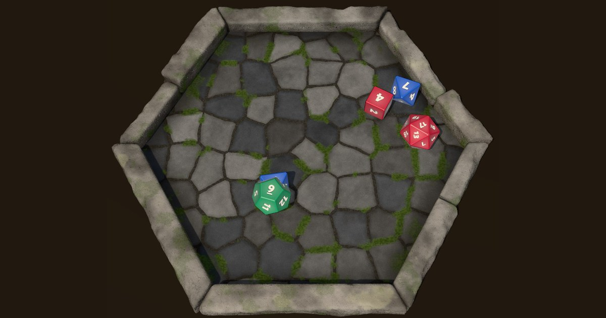

# Tavolo dei Dadi



Tavolo virtuale per lanciare dadi da gioco di ruolo, in tempo reale e senza account. Si crea un tavolo, si condivide il link (come in Google Meet) e chi lo apre sceglie un nickname e il colore dei propri dadi. Tutti vedono gli stessi lanci, con gli stessi numeri: il risultato di ogni dado lo decide il server, il browser anima soltanto la fisica.

In produzione su [lanciadadi.it](https://lanciadadi.it).

## Funzioni

- Tavoli usa-e-getta con link `/t/xxx-xxx-xxx`, ingresso con nickname e colore dei dadi.
- Dadi 3D d4, d6, d8, d10, d12 e d20, fino a 40 per lancio, con fisica e suono. Più lanci possono convivere sul tavolo; chi lancia e chi guarda vedono la stessa traiettoria.
- Vaschetta esagonale con cornice di blocchi di pietra irregolari e pavimento lastricato, generati da codice con seed fisso (uguali per tutti, nessuna texture).
- Click o tap su un proprio dado fermo: nuovo lancio di un dado dello stesso tipo.
- Registro dei lanci con lo storico per chi entra dopo, lista dei giocatori online, pulsante "Esci" con link per rientrare.
- Scadenza: un tavolo fermo da un numero di ore impostabile non è più raggiungibile; i suoi dati restano per le statistiche e vengono poi cancellati.
- Landing page con il tavolo 3D vero e lanci dimostrativi, che su telefono e senza WebGL ripiega su immagini.
- Area admin: statistiche d'uso, equità dei dadi (chi-quadro), elenco dei tavoli con storico dei lanci, pannello delle impostazioni.

## Stack

| Parte | Tecnologia |
|---|---|
| Backend | Laravel 13, PHP 8.3, MySQL o MariaDB |
| Frontend | Blade, JavaScript vanilla, Vite |
| Dadi | Three.js 0.169, cannon-es 0.20 |
| Realtime | Laravel Echo con Reverb (locale) o Pusher (produzione) |
| Admin | Tabler, ApexCharts |
| Test | Pest, Vitest |

## Come funziona il lancio

1. `POST /t/{tavolo}/rolls` riceve solo i tipi di dado. Il server genera i valori con `random_int` e un `seed`, salva il lancio e lo trasmette agli altri sul canale pubblico `table.{codice}`: il codice del tavolo fa da segreto. Chi ha lanciato anima dalla risposta HTTP.
2. Ogni browser calcola in anticipo la fisica con quel `seed`, a passo fisso, e registra tutti i frame. Per ogni dado legge la faccia su cui si ferma e applica una rotazione di simmetria del solido che porta in quella posizione la faccia con il valore deciso dal server. Forma e traiettoria restano identiche, cambiano solo le etichette.
3. A fine animazione il browser rilegge la faccia in alto e la confronta con il server: la spunta verde nel registro.
4. Presenza: heartbeat ogni 20 secondi e avviso all'uscita; chi sparisce senza avvisare viene tolto dopo circa un minuto.
5. Se il servizio realtime non risponde, il lancio riesce comunque: chi lancia lo vede, gli altri lo trovano ricaricando la pagina.

## Installazione in locale

Requisiti: PHP 8.3 (con `pdo_mysql` e `pdo_sqlite`), Composer, Node 20 o successivo, MySQL o MariaDB.

1. Clona il repository e installa le dipendenze:
   ```bash
   composer install
   npm install
   ```
2. Crea il file di configurazione e la chiave dell'applicazione:
   ```bash
   cp .env.example .env
   php artisan key:generate
   ```
3. Crea un database vuoto e imposta in `.env` `DB_DATABASE`, `DB_USERNAME` e `DB_PASSWORD`.
4. Configura Reverb per lo sviluppo. In locale i valori possono essere inventati; una stringa casuale si ottiene con `php -r 'echo bin2hex(random_bytes(10));'`:
   ```dotenv
   BROADCAST_CONNECTION=reverb
   REVERB_APP_ID=<un numero qualsiasi, per esempio 100001>
   REVERB_APP_KEY=<stringa casuale>
   REVERB_APP_SECRET=<stringa casuale>
   REVERB_HOST=localhost
   REVERB_PORT=8080
   REVERB_SCHEME=http
   ```
5. Crea le tabelle, i ruoli, gli utenti di prova e le impostazioni dei tavoli:
   ```bash
   php artisan migrate --seed
   ```
6. Avvia i tre processi, ciascuno in un terminale:
   ```bash
   php artisan serve          # applicazione su http://localhost:8000
   php artisan reverb:start   # WebSocket: senza, gli altri non vedono i lanci in tempo reale
   npm run dev                # Vite
   ```
   Non serve un queue worker: gli eventi vengono trasmessi subito. Per provare anche la scadenza dei tavoli, in un quarto terminale `php artisan schedule:work`.
7. Apri `http://localhost:8000`, crea un tavolo e apri il link in un altro browser. Per provare due giocatori sulla stessa macchina usa due host diversi (`localhost` e `127.0.0.1`), perché le schede dello stesso profilo condividono la sessione.

L'area admin è su `http://localhost:8000/login`. Il seeder crea `admin@example.com` e `user@example.com`, entrambi con password `password`: valgono solo in locale. La registrazione pubblica è disattivata nelle rotte.

### Comandi utili

```bash
vendor/bin/pest                      # test PHP (sqlite in memoria, non toccano il database locale)
npm run test:js                      # test dei moduli dei dadi, in Node
vendor/bin/pint                      # formattazione del codice
npm run build                        # build di produzione in public/build
php artisan tavolo:prune --dry-run   # quanti tavoli verrebbero cancellati
```

In locale, dalla console del browser, `window.__tavolo.selfTest(150)` lancia 150 volte ogni tipo di dado e conta le discrepanze tra faccia mostrata e valore del server.

## Impostazioni dei tavoli

Si modificano da `/admin/settings` e valgono subito per tutti i tavoli, anche quelli già aperti. `SettingsSeeder` crea le chiavi mancanti senza toccare quelle già salvate.

| Impostazione | Valori | Significato |
|---|---|---|
| Scadenza del tavolo | 1–24 ore, predefinito 24 | ore senza attività dopo cui il tavolo non è più raggiungibile |
| Numero massimo di tavoli | 0 = nessun limite | tavoli aperti nello stesso momento |
| Messaggio a tavoli esauriti | testo | mostrato in home al posto dei pulsanti |
| Numero massimo di giocatori | 0 = nessun limite | giocatori in un tavolo |
| Messaggio a tavolo pieno | testo, `:max` = numero di giocatori | mostrato a chi prova a entrare |
| Storico consultabile | 10–100 lanci, predefinito 20 | lanci mostrati a chi entra e tenuti nel registro |

## Variabili d'ambiente del tavolo

| Variabile | Predefinito | Significato |
|---|---|---|
| `BROADCAST_CONNECTION` | `log` | `reverb` in locale, `pusher` in produzione |
| `TAVOLO_EXPIRE_HOURS` | `24` | scadenza iniziale, prima che venga salvata dal pannello |
| `TAVOLO_RETENTION_DAYS` | `30` | giorni in cui i dati di un tavolo scaduto restano per le statistiche; `0` cancella subito |
| `REVERB_*` | | server Reverb (`REVERB_APP_ID/KEY/SECRET`, `REVERB_HOST/PORT/SCHEME`) |
| `REVERB_CLIENT_HOST/PORT/SCHEME` | come `REVERB_*` | opzionali: come il browser raggiunge Reverb, se diverso da come lo raggiunge il server (dietro un proxy) |
| `PUSHER_APP_ID/KEY/SECRET/CLUSTER` | | credenziali Pusher per la produzione |

La configurazione realtime del browser viene letta a runtime dal `.env` e iniettata nella pagina: il build non contiene host né chiavi.

## Struttura del codice

```
app/Services/          RoomService, RollService, PresenceService, StatsService, SettingsService
app/Events/            DiceRolled, ParticipantJoined, ParticipantLeft (ShouldBroadcastNow)
app/Support/           SafeBroadcast, ChiSquare
config/tavolo.php      valori predefiniti e configurazione realtime
resources/js/dice/     geometry.js, physics.js, stone.js, selftest.js (senza DOM, testati in Node),
                       scene.js (renderer e materiali), audio.js
resources/js/          table.js, join.js, landing.js, landing-stage.js, landing-rolls.js, echo.js
resources/icons/       favicon.py (genera favicon e icone in public/)
prototype/             prototipo originale in un solo file HTML, come riferimento
tests/                 Feature e Unit (Pest), js (Vitest)
```

## Deploy su Cloudways

Il realtime in produzione usa Pusher: Reverb richiederebbe un processo sempre attivo e un proxy WebSocket, che su Cloudways non si configurano in autonomia. Reverb resta per lo sviluppo locale; si passa dall'uno all'altro solo con `BROADCAST_CONNECTION`.

### 1. Pusher

Nel dashboard di Pusher crea un'app Channels (frontend "Vanilla JS", backend "Laravel") con il cluster europeo `eu`. Servono quattro valori: `app_id`, `key`, `secret`, `cluster`. Il `secret` va solo nel `.env` del server, mai nel repository. Se viene condiviso per sbaglio, rigeneralo dal dashboard (App Keys, Reset secret) e aggiorna il `.env`.

### 2. Applicazione e database

1. Nel pannello Cloudways crea un'applicazione Laravel (PHP 8.3 o successivo) con il suo database MySQL o MariaDB. La web root deve puntare alla cartella `public/`.
2. Porta il codice sul server, per esempio con il deploy da Git del pannello, poi in SSH:
   ```bash
   cd <cartella-applicazione>
   composer install --no-dev --optimize-autoloader
   ```
3. Il frontend non si compila sul server: `public/build` è versionato. In locale esegui `npm run build` e fai commit di `public/build` prima di ogni deploy. Sul server non deve esistere `public/hot`.

### 3. File `.env` di produzione

Valori da impostare, con i segreti inseriti a mano sul server:

```dotenv
APP_ENV=production
APP_DEBUG=false
APP_URL=https://<il-tuo-dominio>
APP_KEY=<generata con php artisan key:generate --show>

DB_CONNECTION=mysql
DB_HOST=127.0.0.1
DB_DATABASE=<nome>
DB_USERNAME=<utente>
DB_PASSWORD=<password>

SESSION_DRIVER=database
CACHE_STORE=database
QUEUE_CONNECTION=database

BROADCAST_CONNECTION=pusher
PUSHER_APP_ID=<da Pusher>
PUSHER_APP_KEY=<da Pusher>
PUSHER_APP_SECRET=<da Pusher, solo qui>
PUSHER_APP_CLUSTER=eu

TAVOLO_EXPIRE_HOURS=24
TAVOLO_RETENTION_DAYS=30
```

Con il certificato HTTPS attivo, `APP_URL` deve iniziare con `https://`.

### 4. Primo avvio del database

```bash
php artisan migrate --force
php artisan db:seed --class=UserRolesSeeder --force   # ruoli admin e user
php artisan db:seed --class=SettingsSeeder --force    # impostazioni dei tavoli
php artisan config:cache && php artisan route:cache && php artisan view:cache
```

Non lanciare `db:seed` completo in produzione: crea utenti con password `password`. L'amministratore si crea con `php artisan tinker`:

```php
$u = App\Models\User::create(['name' => 'Il tuo nome', 'email' => 'tu@esempio.it', 'password' => bcrypt('<password robusta>'), 'status' => true]);
$u->assignRole('admin');
```

### 5. Aggiornamenti successivi

```bash
composer install --no-dev --optimize-autoloader
php artisan migrate --force
php artisan db:seed --class=SettingsSeeder --force    # solo se sono state aggiunte impostazioni
php artisan config:cache && php artisan route:cache && php artisan view:cache
```

### 6. Cron per la scadenza dei tavoli

Senza cron i tavoli scaduti restano nel database (non sono comunque raggiungibili). In Cron Job Management aggiungi un job ogni minuto con il percorso reale dell'applicazione (controllalo in SSH con `pwd`):

```
cd <percorso-applicazione> && php artisan schedule:run >> /dev/null 2>&1
```

### 7. Verifica dopo il deploy

1. Apri la home, crea un tavolo ed entra con un nickname.
2. Apri il link in un secondo browser o in una finestra privata ed entra con un altro nickname: ognuno deve comparire nella lista "Al tavolo" dell'altro.
3. Lancia un d20 in una finestra: il lancio deve comparire anche nell'altra, con lo stesso numero.
4. Entra in `/admin/home` con l'utente admin.

### Problemi frequenti

| Sintomo | Causa probabile |
|---|---|
| Errore WebSocket in console, i lanci degli altri non arrivano | `BROADCAST_CONNECTION` non è `pusher`, credenziali o cluster sbagliati, `.env` cambiato senza `php artisan config:clear` |
| Il lancio arriva solo a chi lo fa; in `storage/logs` c'è `BroadcastException` | Pusher non raggiungibile o chiave e segreto errati |
| `Failed to resolve module specifier "lodash"` | build vecchio: rifai `npm run build` e il commit di `public/build` |
| Il browser cerca `localhost:8080` | build o configurazione vecchi: rifai il build e `config:clear` |
| "Tavolo scaduto" | il tavolo era fermo da più ore della scadenza impostata: ne serve uno nuovo |
| Sul server compaiono file da `localhost:5173` | esiste `public/hot`: eliminalo |

## Base del progetto

Il tavolo è costruito sopra il boilerplate Laravel di Giacomo Piva, che resta intatto: area admin con il tema [Tabler](https://tabler.io/admin-template), autenticazione con `laravel/ui`, ruoli e permessi con `spatie/laravel-permission`, cifratura dei campi, backup, log viewer, export Excel e PDF. Le dipendenze complete sono in `composer.json`.

## Autore

[Giacomo Piva](https://www.giacomopiva.com)
